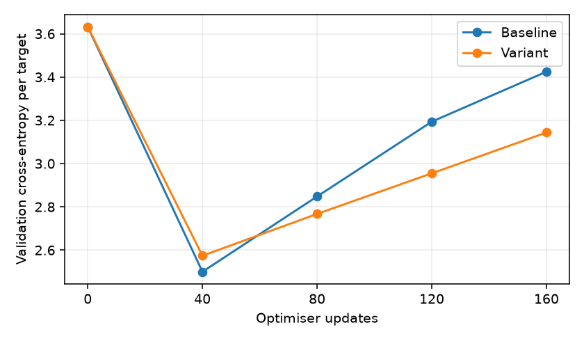

# Tiny Transformer from Scratch: Does Head Count Matter?

A small **causal (decoder-style) Transformer** built in PyTorch to predict the next character. The project tests the model's internals with unit-style checks, diagnoses a masking bug, and runs a controlled experiment comparing **4 attention heads with 2**.

*Individual coursework for the Generative AI with LLMs module (ST1520) at Singapore Polytechnic, extending the module's Lab 3 scaffold.*

## Results

| | Baseline (4 heads) | Variant (2 heads) |
|---|---|---|
| Parameters | 14,718 | 14,718 |
| Final training loss | 0.248 | 0.270 |
| Final validation loss | 3.425 | **3.144** |
| Validation accuracy (next character) | 41.3% | **42.9%** |
| Best validation loss (at update 40) | **2.500** | 2.574 |

<p align="center">
  
</p>

- **The hypothesis was not supported.** I expected fewer heads to do worse, but after 160 updates the 2-head model had the lower validation loss.
- **The ranking depends on when you stop.** Both models were best at update 40, where the 4-head model was ahead. After that, validation loss rose while training loss kept falling, which suggests overfitting.
- **This is a single-seed result**, so it does not show that 2 heads are generally better.
- **Controlled comparison:** both runs started from identical weights and saw the same batch sequence (checked with SHA-256 hashes), so the head count was the only difference.

## What's tested

- **Shape trace:** Q, K and V go from `[1,4,32]` to `[1,4,4,8]` per head; attention weights are `[1,4,4,4]`; logits are `[1,4,30]`.
- **Causal mask:** changing the last input token changes earlier logits by 0.1225 without the mask and **0.0** with it.
- **Edge cases:** a single-token input, attention rows summing to 1, finite gradients, and rejection of width/head combinations that do not divide evenly.
- **Fault diagnosis:** a mask with `diagonal=0` also blocks each token from seeing itself. The first row then becomes all −∞ and softmax returns NaN. The fix is `diagonal=1`.
- **Save and reload:** the reloaded model gives identical logits (maximum difference 0.0).

## Model

Character embedding → sinusoidal positional encoding → one Transformer block (layer norm → multi-head causal self-attention with separate Q/K/V projections → residual → layer norm → feed-forward → residual) → final layer norm → vocabulary logits.

Width 32 · context 24 · feed-forward 128 · 30-character vocabulary · AdamW (lr 0.003, weight decay 0.01) · batch 32 · gradient clipping 1.0 · 160 updates · seed 4366 · CPU only.

## Files

| Path | Description |
|---|---|
| `tiny_transformer_attention_heads.ipynb` | Implementation, tests, training, experiment and explanations, with outputs |
| `CA1_evidence/results.json` | Settings, metrics, loss history and generated text for both runs |
| `CA1_evidence/baseline.pt`, `baseline_config.json` | Saved baseline model and config |
| `CA1_evidence/split.json` | Train / validation document split |
| `CA1_evidence/validation_loss.png` | Validation-loss curves |

## Run it

```bash
pip install -r requirements.txt
jupyter notebook tiny_transformer_attention_heads.ipynb
```

Tested with Python 3.11, PyTorch 2.15 (CPU), NumPy 2.4 and Matplotlib 3.11.

## Author

**Phyu Sin Lynn (Emi)** — [Portfolio](https://emi-psl.github.io/portfolio/) · [GitHub](https://github.com/emi-psl) · [LinkedIn](https://www.linkedin.com/in/phyusinlynn)
